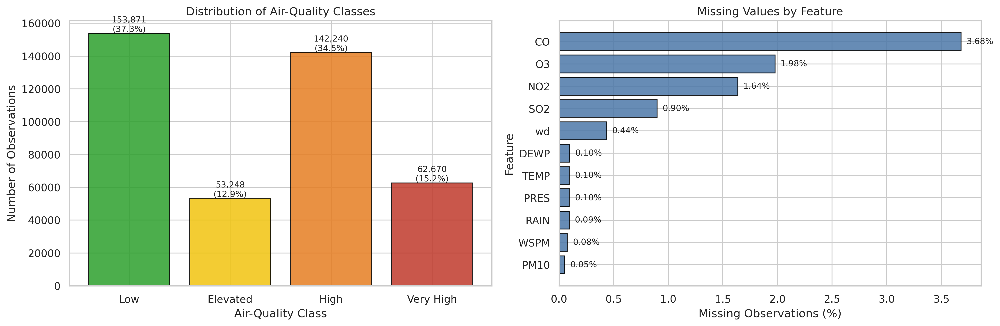
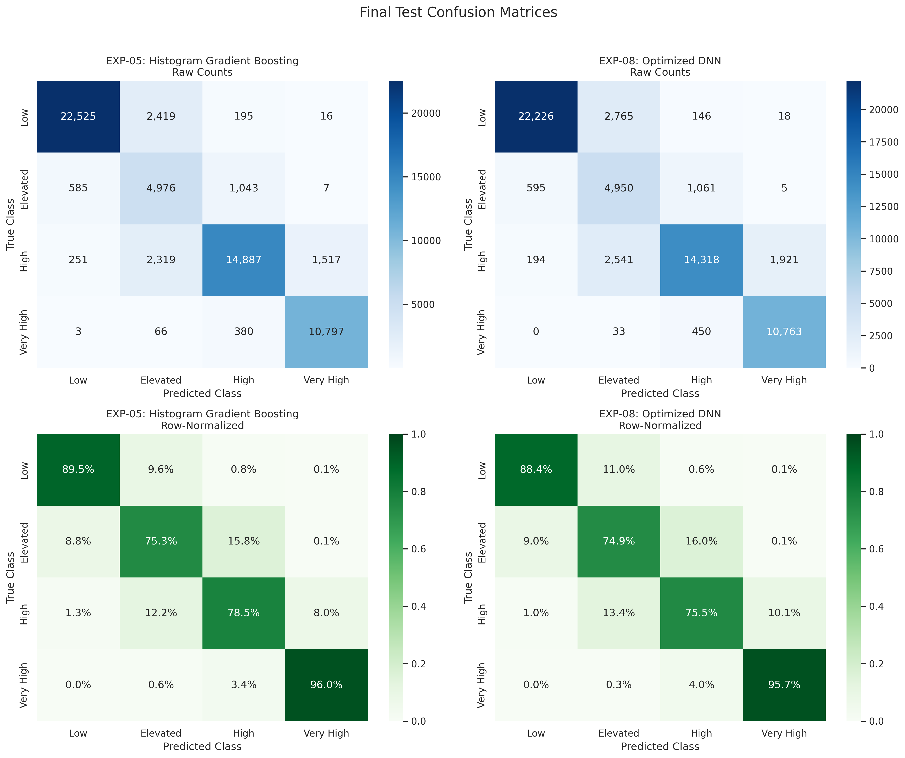
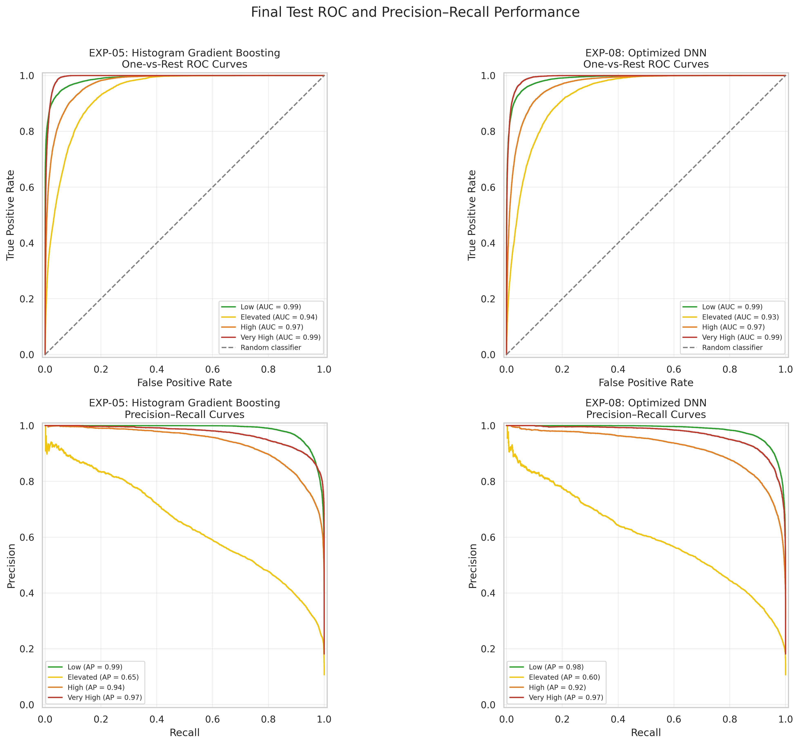
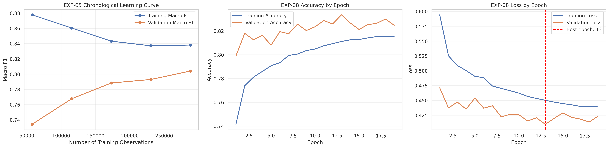
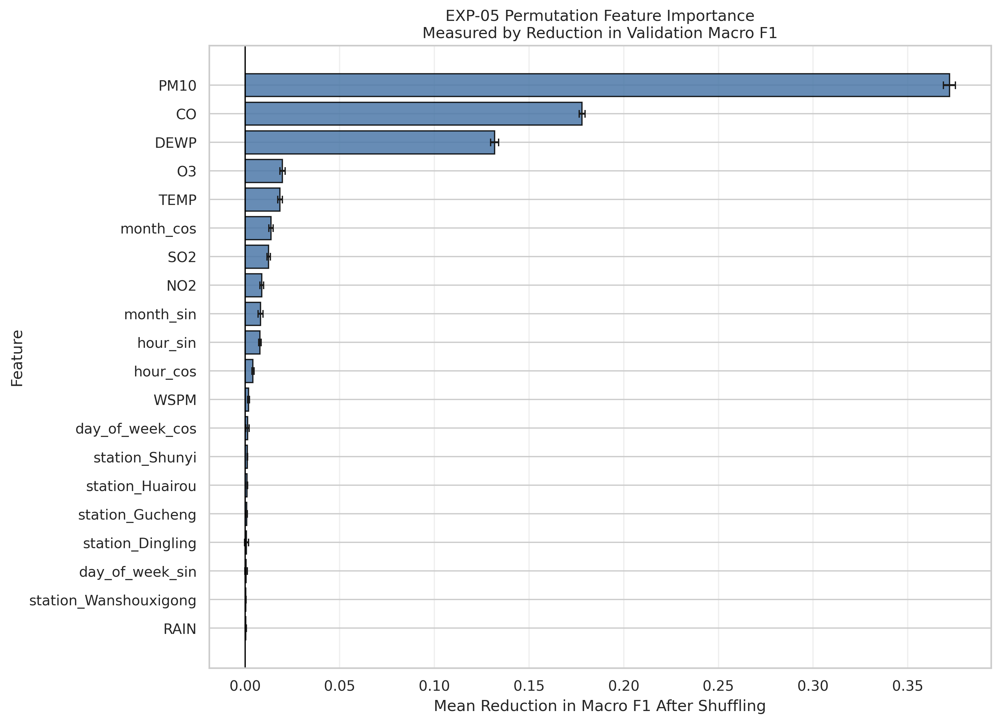
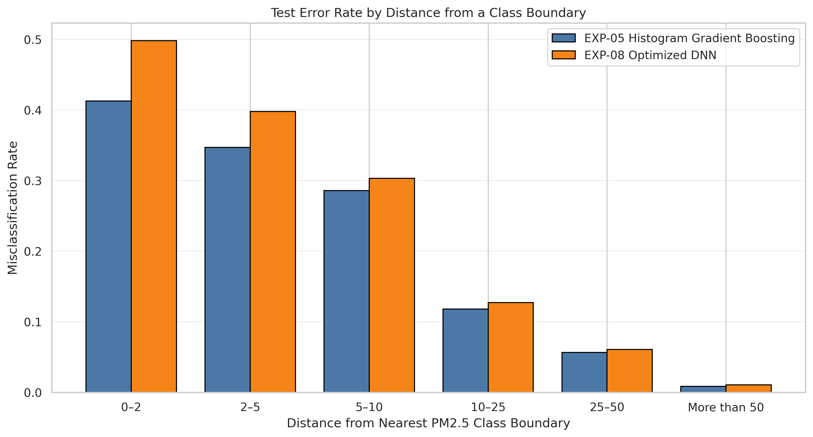

# Beijing Air Quality Classification

This project compares traditional machine-learning and deep-learning approaches for classifying hourly air-quality conditions in Beijing into four PM2.5 severity groups. It uses a leakage-aware chronological split so that models are evaluated on observations collected after the training period.

## Project overview

The analysis uses the Beijing Multi-Site Air Quality dataset, which contains hourly pollutant and meteorological measurements from 12 monitoring stations between March 2013 and February 2017. The raw data contains 420,768 observations; 412,029 observations remain after rows with missing PM2.5 targets are removed.

The four project-defined target classes are:

| Class | Label | PM2.5 range |
|---:|---|---:|
| 0 | Low | ≤ 35.4 |
| 1 | Elevated | 35.4–55.4 |
| 2 | High | 55.4–150.4 |
| 3 | Very High | > 150.4 |

These labels are grouped concentration bands for this project and should not be interpreted as the complete official AQI classification system.

## Methods

The workflow includes:

- Chronological 70% training, 15% validation, and 15% test partitions
- Training-only, station-specific median imputation
- Missingness indicators and cyclical time features
- One-hot encoding of station and wind direction
- Standardization fitted only on the training partition
- Five traditional machine-learning experiments
- Three TensorFlow/Keras neural-network experiments using `tf.data`
- TensorBoard tracking, early stopping, class weighting, regularization, and learning-rate scheduling
- Evaluation with accuracy, macro precision, macro recall, macro-F1, weighted F1, ROC-AUC, confusion matrices, ROC curves, precision-recall curves, and learning curves
- Permutation feature importance and class-boundary error analysis

## Experiments

Eight configurations were compared on the validation partition:

| ID | Model | Validation accuracy | Validation macro-F1 | Validation ROC-AUC |
|---|---|---:|---:|---:|
| EXP-01 | Logistic Regression baseline | 0.7917 | 0.7076 | 0.9367 |
| EXP-02 | Class-weighted Logistic Regression | 0.7592 | 0.7406 | 0.9376 |
| EXP-03 | Random Forest baseline | 0.8260 | 0.7642 | 0.9601 |
| EXP-04 | Regularized class-weighted Random Forest | 0.8244 | 0.7974 | 0.9590 |
| EXP-05 | Histogram Gradient Boosting | 0.8233 | 0.8041 | 0.9646 |
| EXP-06 | Baseline MLP | 0.8338 | 0.7899 | 0.9598 |
| EXP-07 | Regularized class-weighted DNN | 0.8240 | 0.8060 | 0.9642 |
| EXP-08 | Optimized DNN with learning-rate scheduling | **0.8335** | **0.8125** | **0.9669** |

EXP-05 was selected as the best traditional model, while EXP-08 was selected as the best deep-learning model. Model selection used validation macro-F1; the test partition was evaluated only after selection.

## Final test results

| Model | Accuracy | Macro precision | Macro recall | Macro-F1 | Weighted F1 | Macro ROC-AUC |
|---|---:|---:|---:|---:|---:|---:|
| Histogram Gradient Boosting | **0.8580** | **0.8125** | **0.8482** | **0.8226** | **0.8646** | **0.9731** |
| Optimized DNN | 0.8430 | 0.7975 | 0.8360 | 0.8067 | 0.8508 | 0.9689 |

Histogram Gradient Boosting produced the strongest final performance. The Elevated class was the most difficult for both models. Boundary analysis showed that EXP-05's error rate was 41.27% within two PM2.5 units of a class threshold, compared with 0.83% more than 50 units from a threshold. This indicates that many errors involved borderline observations.

## Key figures

### Class distribution and missingness



### Final test confusion matrices



### ROC and precision-recall curves



### Learning curves



### Permutation feature importance



### Boundary error analysis



## Repository structure

```text
.
├── notebook/
│   └── Beijing_Air_Quality_Classification.ipynb
├── results/
│   └── figures/
├── .gitignore
├── LICENSE
├── README.md
└── requirements.txt
```

The raw dataset, saved model files, preprocessing artifacts, and TensorBoard logs are stored separately in Google Drive and are intentionally excluded from this repository.

## Installation

Create and activate a virtual environment, then install the pinned dependencies:

```bash
python -m venv .venv
```

On Windows PowerShell:

```powershell
.venv\Scripts\Activate.ps1
pip install -r requirements.txt
```

The notebook was developed in Google Colab. Its Drive paths must be adjusted if it is run in another environment.

## Running the notebook

1. Download the Beijing Multi-Site Air Quality dataset ZIP.
2. Place it in the Google Drive project `data` directory used by the notebook.
3. Open `notebook/Beijing_Air_Quality_Classification.ipynb` in Google Colab.
4. Update `PROJECT_DIR` in the setup cell if your Drive folder has a different name.
5. Run all cells from top to bottom.

The raw dataset is not committed to GitHub, in accordance with the project requirements.

## Main findings

- Histogram Gradient Boosting slightly outperformed the optimized neural network while training faster.
- PM10, CO, and dew point were the most influential predictors in the selected traditional model.
- Very High conditions were identified reliably by both final models.
- Elevated conditions were hardest to distinguish because they lie between neighboring severity groups.
- Validation macro-F1 improved as the chronological training sample increased, suggesting that additional representative data may further improve generalization.

## Limitations

- The target uses project-defined grouped PM2.5 bands rather than the complete AQI system.
- Hourly measurements from the same stations are temporally dependent.
- Missing sensor values required training-derived imputation.
- Pollution patterns and class prevalence changed across time.
- Results from Beijing may not generalize to cities with different climates or pollution sources.

## License

This repository is provided under the [MIT License](LICENSE).
